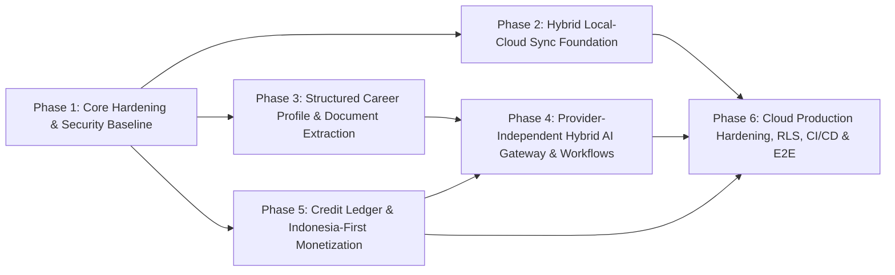

# Development Backlog — Evolution to Hybrid AI Career Management Platform

**Baseline:** Personal ATS v0.1.0 (All 5 core ATS phases + UI/UX primitive foundation complete)  
**Priority Order:** Data Integrity → Security → Reliability → AI Quality → Monetization → User Experience  
**Rule:** Do not duplicate existing features (`suitability.ts`, `email-classifier.ts`, `documents`, `interviews`, `analytics`, `Better Auth`, `Drizzle + PGlite/Postgres`).

---

## Dependency Graph Across Future Phases

---

## Phase 1 — Core Data Integrity, Security & Component Hardening (Recommended Next)
**Goal:** Close verified gaps in the existing ATS before adding sync, AI, or billing.
- **P1.1 Transactional Integrity & Atomic Sequences:** Wrap multi-step writes (`recordSubmissionService`, `moveApplicationStageService`, `createVacancyService`, `uploadOrVersionDocumentService`) in `db.transaction(...)` and allocate `nextApplicationSeq` / `nextJobSeq` atomically.
- **P1.2 Relational FK Cleanup:** Add migrations for `applications.cvVersionId`/`coverLetterVersionId`, `emailCommunications.emailAccountId`, `interviews.stageId`, and `applicationStatusHistory.fromStageId` with safe `ON DELETE` rules.
- **P1.3 Security & UU PDP Fixes:**
  - Clean up `storage/documents/<userId>` files during `deleteUserAccountService`.
  - Complete `exportAccountJsonService` (`assessments`, `documents`, `documentVersions`, `applicationDocuments`, non-secret `emailAccounts`, `notifications`).
  - Harden `verifyOAuthState` (`timingSafeEqual` + 10-min expiry), `resolveSafeStoragePath` (`root + sep`), document file `Content-Security-Policy: sandbox`, and `next.config.ts` CSP/HSTS headers.
  - Add Zod validation to remaining Server Actions (`settings.ts`, `applications.ts`, `emails.ts`).
- **P1.4 Query & UI Stability:** Ensure `getDashboardData` (`recentActivity`, `upcomingInterviews`, `pendingFollowUps`) consistently honors `includeSample`, and split `application-detail-client.tsx` (1,807 lines) into tab modules to prepare for AI panels.

## Phase 2 — Hybrid Deployment & Optional Local ↔ Cloud Sync
**Goal:** Support Local-only (`PGlite`), Cloud-only (`PostgreSQL`), and Hybrid (`PGlite` + optional Cloud Sync) cleanly.
- **P2.1 Sync Schema & Tombstones:** Add `sync_version`, `updated_at`, `deleted_at` (soft-delete tombstones) on user domain tables, plus `sync_devices` and `sync_checkpoints` tables.
- **P2.2 Sync Protocol & Conflict Resolution:** Implement opt-in authenticated delta push/pull APIs with per-user isolation, last-write-wins / field-level conflict rules, and never sync sensitive local-only secrets unless explicitly opted in.
- **P2.3 Storage Provider Abstraction:** Abstract `src/lib/storage.ts` behind a `StorageAdapter` (`LocalFsStorage` + `CloudObjectStorage` S3/Supabase) so synced `document_versions` resolve seamlessly.

## Phase 3 — Structured Career Profile & Document Text Extraction
**Goal:** Create a verified factual career knowledge base so AI features never fabricate achievements (Rule 11).
- **P3.1 Structured Career Data Schema:** Add `career_experiences`, `career_projects`, `career_educations`, `career_certifications` tables + UI editor in Profile/Settings.
- **P3.2 Document Text Extraction Pipeline:** Extract text from uploaded PDF/DOCX/TXT/MD in `documents` into `document_extracted_contents` (cached by SHA-256), with user-editable parsed preview.

## Phase 4 — Provider-Independent Hybrid AI Engine
**Goal:** Evolve deterministic suitability/email/career tools with optional Local AI + Cloud AI behind a single provider-independent interface.
- **P4.1 Provider-Independent AI Gateway (`src/server/ai/`):**
  - Unified interface (`complete`, `completeStructured` with Zod output validation, healthcheck, token/latency accounting).
  - Adapters: Local AI (e.g., Ollama / OpenAI-compatible local endpoint / on-device) and Cloud AI (OpenAI / Gemini / Anthropic via server-side keys, without vendor lock-in).
  - Deterministic fallback always preserved (`suitability.ts`, `email-classifier.ts`).
- **P4.2 Traceability & Safety Layer:** `ai_runs` audit table, prompt-injection delimiters, PII redaction filter before cloud calls, and mandatory user confirmation before persisting any AI-suggested profile/CV/stage edit.
- **P4.3 High-Value AI Workflows (Indonesia + Global):**
  - JD requirement extractor & gap analysis (extends `suitability.ts`).
  - Grounded CV tailoring & cover letter drafting (EN & Bahasa Indonesia, citing only verified profile/document facts).
  - AI interview preparation brief & mock Q&A grounded in vacancy + `interviews` notes.
  - AI-assisted email triage for ambiguous messages that deterministic `email-classifier.ts` marks `other_recruitment` or low-confidence.

## Phase 5 — Credit-Based / Pay-Per-Use Monetization (Indonesia First)
**Goal:** Introduce transparent pay-per-use credit accounting for Cloud AI features while keeping Local ATS & Local AI accessible.
- **P5.1 Credit Ledger & Atomic Accounting:** `credit_wallets`, append-only `credit_ledger_entries`, `ai_action_pricing`, atomic reserve/commit/refund wrapped around `ai_runs`.
- **P5.2 Indonesia-First Billing & Top-Ups:** `credit_packages` (IDR-denominated starter/pro packs), payment gateway adapter (Midtrans/Xendit) with verified signed webhooks, invoice/receipt history, and global currency extensibility (USD).
- **P5.3 Usage & Balance UX:** Credit balance indicator in AppShell, pre-run cost estimate before Cloud AI invocation, usage breakdown in Settings/Billing.

## Phase 6 — Production Hardening, PostgreSQL RLS, CI/CD & Full E2E
> **Status (2026-11-17):** P6.2 delivered — `.github/workflows/ci.yml` runs `typecheck`, `lint`, `test` (in-memory PGlite), `build`, and `test:e2e` on push/PR (a PostgreSQL service-matrix leg remains future work). P6.1 RLS remains deferred as the accepted exception DEF-11-006. P6.3 partially delivered — Playwright core-journey + accessibility/keyboard suites are in place; automated retention reminders remain open.
**Goal:** Make cloud multi-tenant deployment production-grade.
- **P6.1 PostgreSQL Row-Level Security (RLS):** Add cloud-safe RLS policies for PostgreSQL/Supabase deployments without breaking local PGlite.
- **P6.2 CI/CD Pipeline:** Add GitHub Actions running `typecheck`, `lint`, `test` (both PGlite and PostgreSQL service), `build`, and `test:e2e`.
- **P6.3 Compliance & Ops:** Automated retention reminders (UU PDP 24-month review), structured audit/security logging, and full Playwright E2E coverage for AI, Sync, and Credit flows.
