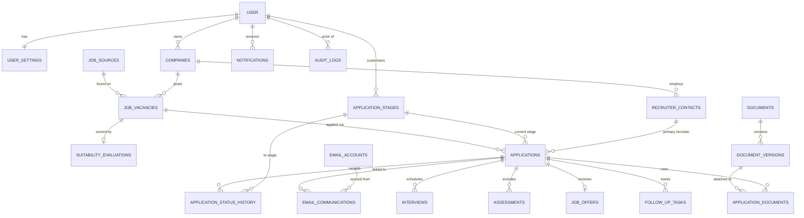

# 04. Database Schema

The database is a normalized relational schema managed with Drizzle ORM. It runs identically on **PGlite** (local embedded PostgreSQL) and **Supabase / PostgreSQL** (production).

## Entity Relationship Diagram

## Core Integrity & Isolation Rules

1. **Per-user tenant isolation**: Every domain table includes a `user_id` column referencing `user.id` (`ON DELETE CASCADE`).
2. **Composite Foreign Keys**: Child tables reference parent records via composite keys `(parent_id, user_id) -> parent(id, user_id)` so a record can never link to another user's entity.
3. **Duplicate Submission Protection**:
   - `applications_one_active_per_vacancy_uq`: Partial unique index `ON (vacancy_id) WHERE outcome = 'active'` prevents accidental duplicate active applications to the same position.
   - `applications_vacancy_attempt_uq`: Unique index `ON (vacancy_id, attempt_number)` requires explicit attempt increments (`reapply_reason`) when re-applying to a previously closed vacancy.
   - `job_vacancies_user_url_uq`: Partial unique index `ON (user_id, normalized_url) WHERE normalized_url IS NOT NULL` prevents duplicate saved URLs.
4. **Append-only History & Audit**: `application_status_history` and `audit_logs` are append-only tables.

## Table Summary

| Table | Primary Key | Notable Constraints & Indexes |
|---|---|---|
| `user`, `session`, `account`, `verification` | `id` (`text`) | Managed by Better Auth; `user.email` unique |
| `user_settings` | `user_id` (`text`) | Check constraints on follow-up intervals and no-response threshold |
| `companies` | `id` (`uuid`) | Unique `(user_id, normalized_name)` |
| `recruiter_contacts` | `id` (`uuid`) | Composite FK to `companies` |
| `job_sources` | `id` (`uuid`) | Seeded system sources (`user_id IS NULL`) + custom user sources |
| `job_vacancies` | `id` (`uuid`) | Unique `(user_id, code)`, unique `(user_id, normalized_url)`, salary check |
| `suitability_evaluations` | `id` (`uuid`) | Unique `(vacancy_id)`, 0 to 100 check on all six criterion scores |
| `application_stages` | `id` (`uuid`) | Unique `(user_id, key)`, indexed by `(user_id, sort_order)` |
| `applications` | `id` (`uuid`) | Unique `(user_id, code)`, partial unique active per vacancy, composite FKs |
| `application_status_history` | `id` (`uuid`) | Append-only, indexed by `(application_id, effective_on, recorded_at)` |
| `email_accounts` | `id` (`uuid`) | Unique `(user_id, provider, email)` |
| `email_communications` | `id` (`uuid`) | Unique `(user_id, source, provider_message_id)` for de-duplication |
| `interviews` | `id` (`uuid`) | Composite FK to `applications`, indexed by `(user_id, starts_at)` |
| `assessments` | `id` (`uuid`) | Composite FK to `applications` |
| `job_offers` | `id` (`uuid`) | Unique `(application_id)`, composite FK to `applications` |
| `documents`, `document_versions`, `application_documents` | `id` (`uuid`) | Unique `(document_id, version_no)` |
| `follow_up_tasks` | `id` (`uuid`) | Indexed by `(user_id, status, due_on)` |
| `notifications` | `id` (`uuid`) | Indexed by `(user_id, read_at)` |
| `audit_logs` | `id` (`uuid`) | Indexed by `(user_id, created_at)` |
