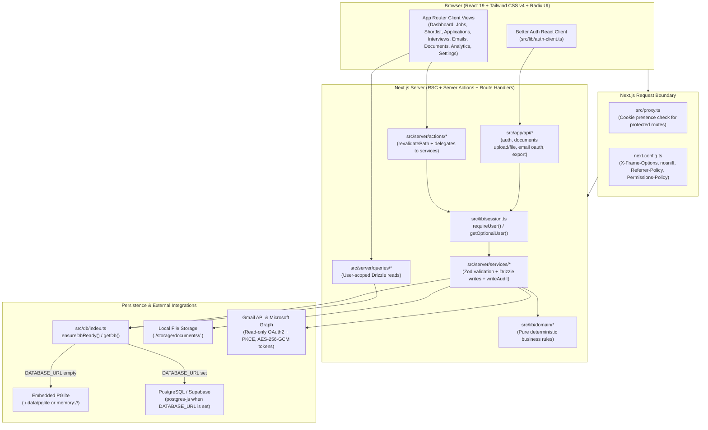

# Current Technical Architecture

**System:** Career Application Tracker (`Trackr ATS`)  
**Framework:** Next.js 16.4.6 (App Router, Turbopack), React 19.3, TypeScript 5 (strict)

---

## 1. High-Level System Architecture

---

## 2. Layer Responsibilities

### 2.1 Routing & Request Protection
- **`src/proxy.ts`:** Runs as Next.js Proxy (Middleware) on protected page and `/api/export`, `/api/documents` paths. Checks for cookie name containing `better-auth.session_token`; unauthenticated page requests redirect to `/sign-in?next=...` and API requests return HTTP `401`.
- **`src/app/(app)/layout.tsx`:** Marks authenticated workspace as `dynamic = "force-dynamic"`, invokes `requireUser()`, loads `getSampleDataStatus` and `getNotificationsSummary`, and wraps all child pages in `AppShell`.
- **Every Page & Server Action:** Independently calls `requireUser()` (`src/lib/session.ts`), which executes `ensureDbReady()`, validates the Better Auth database session via `getAuth().api.getSession({ headers })`, redirects to `/sign-in` if absent, and runs idempotent `ensureUserInitialized(db, user.id)`.

### 2.2 Database Runtime Abstraction (`src/db/index.ts`)
The database layer supports two modes via a single Drizzle schema (`dialect: "postgresql"`):
1. **Local Embedded Mode (`DATABASE_URL` empty):**
   - Uses `@electric-sql/pglite` persisted to `PGLITE_DATA_DIR` (default `./.data/pglite`) or `memory://` in `NODE_ENV === "test"` / E2E.
   - Binds `SIGINT`, `SIGTERM`, `beforeExit` handlers for graceful PGlite shutdown.
2. **Cloud / Server Mode (`DATABASE_URL` non-empty):**
   - Uses `postgres` (`postgres-js` with `{ prepare: false }` for transaction-pooler compatibility) wrapped with `drizzle-orm/postgres-js`.
3. **Auto-Migration & System Seeding (`ensureDbReady()`):**
   - Caches a singleton `readyPromise` on `globalThis.__catDbState`.
   - Applies SQL migrations from `src/db/migrations` and seeds shared `job_sources` (`seedSystemSources`).
   - Supports `setTestDb()` injection for isolated Vitest integration tests.

### 2.3 Authentication (`src/lib/auth.ts`)
- Powered by `better-auth` (`1.7.25`) with `drizzleAdapter(..., { provider: "pg" })` and `nextCookies()` plugin.
- Enabled method: `emailAndPassword` (`minPasswordLength: 10`, `maxPasswordLength: 128`, `autoSignIn: true`).
- `databaseHooks.user.create.after` automatically runs `ensureUserInitialized` to create `user_settings` and seed the 13 default `application_stages`.
- Mounted via `src/app/api/auth/[...all]/route.ts`.

### 2.4 Business Logic & Server Services
- **Server Queries (`src/server/queries/`):** `analytics.ts`, `applications.ts`, `career.ts`, `dashboard.ts`, `emails.ts`, `settings.ts`, `vacancies.ts`. Every query receives `userId` from the authenticated session and filters explicitly on `userId`.
- **Server Services (`src/server/services/`):** `applications.ts`, `career.ts`, `emails.ts`, `settings.ts`, `vacancies.ts`. Contain Zod input schemas, business checks, database mutations, and `writeAudit(...)` calls (`src/lib/audit.ts`).
- **Server Actions (`src/server/actions/`):** Thin wrappers calling `requireUser()`, invoking services, and calling `revalidatePath(...)`.
- **Pure Domain Modules (`src/lib/domain/`):** Deterministic logic separated from DB/IO (`stages.ts`, `suitability.ts`, `email-classifier.ts`, `follow-ups.ts`, `business-days.ts`, `duplicates.ts`, `kpi.ts`).

### 2.5 Document Storage & Email OAuth
- **Document Storage (`src/lib/storage.ts`):**
  - Validates file buffer size (1 B – 10 MB) and inspects binary magic bytes (PDF, PNG, JPEG, WebP, DOCX ZIP with `.docx` extension, or `.txt`/`.md` without null bytes or HTML/SVG/script tags).
  - Writes files under `storage/documents/<sanitizedUserId>/<uuid>.<ext>`.
  - Served through `GET /api/documents/versions/[versionId]/file` after verifying `(versionId, userId)` ownership.
- **Email OAuth (`src/lib/email-oauth.ts`, `src/lib/crypto.ts`):**
  - Supports read-only Gmail (`gmail.readonly`) and Microsoft Graph (`Mail.Read`, `offline_access`).
  - Uses PKCE (`S256`) and HMAC-SHA256 signed state cookies (`cat_email_oauth_state`).
  - Encrypts OAuth refresh tokens at rest using AES-256-GCM (`v1.<iv>.<tag>.<ciphertext>`).
  - Email ingestion is strictly read-only, deduplicated on `(userId, source, providerMessageId)`, and **never mutates application stages without explicit user confirmation**.

### 2.6 Frontend & Design System (`DESIGN.md`, `src/app/globals.css`, `src/components/ui/`)
- Tailwind CSS v4 with semantic CSS custom properties (`--background`, `--surface`, `--primary`, `--border`, `--destructive`, etc.) supporting light and dark mode (`next-themes`).
- Shared accessible UI primitives in `src/components/ui/` built on `radix-ui`, `class-variance-authority`, and `lucide-react` (`Button`, `Dialog`, `ConfirmDialog`, `Popover`, `Tabs`, `DropdownMenu`, `Tooltip`, `DataTable`, `FormField`, `Input`, `Select`, `Textarea`, `Badge`, `Card`, `PageHeader`, `EmptyState`/`ErrorState`/`LoadingState`).
- Fonts loaded offline-safe via `geist/font/sans` and `geist/font/mono`.

### 2.7 Hybrid AI Engine (`src/server/ai/`)
- **Providers:** Ollama (local) + OpenAI + Gemini (cloud) behind a provider-agnostic router (`src/server/ai/providers/`).
- **Consent gate:** cloud AI calls require explicit user consent; local mode and deterministic fallbacks work fully offline.
- **Structured output:** Zod schemas per capability (CV parse/evaluate/correct/generate, job match, skill gap, roadmap) in `src/server/ai/schemas/`.
- **Prompt-injection defense** and grounding rules: AI outputs never mutate career facts or pipeline state without explicit user confirmation (`src/server/ai/security/`).

### 2.8 Credits & Payments (`src/lib/domain/credits.ts`, `src/lib/domain/payments.ts`, `src/server/payments/`)
- **Atomic credit wallet:** server-authoritative balance using `FOR UPDATE` row locks + compare-and-swap updates + idempotency keys; append-only ledger and reservations.
- **Providers:** Midtrans (webhook signature SHA-512 verification) and Stripe (webhook HMAC verification); checkout, webhook ingestion, and refunds.
- All monetization flows degrade gracefully when gateway credentials are unconfigured.

### 2.9 Hybrid Sync & API v1 (`src/server/sync/`, `src/app/api/v1/`)
- **Outbox pattern:** local changes queued for push, remote changes pulled; version-based conflict detection with explicit resolution; replay-safe operations.
- **API v1:** versioned route handlers with session/API-key auth, Zod validation, per-route rate limiting, and idempotency keys.

### 2.10 Localization (`src/lib/i18n/`)
- Two markets: Indonesia (`id-ID`, IDR, `Asia/Jakarta`) and Global (`en-US`, USD). Locale cookie drives the SSR `<html lang>` attribute, currency, and date formatting.

### 2.11 Security Headers & Error Handling
- Global environment-aware `Content-Security-Policy` in `next.config.ts`; inline document responses served with `CSP: sandbox`.
- Server services throw typed `DomainError` (`src/lib/errors.ts`); route handlers return domain messages as 400 and sanitize unexpected errors to a generic 500.

---

## 3. Architectural Constraints for Evolution

Any new feature in the Hybrid AI Career Management Platform must respect:
1. **PostgreSQL + PGlite Schema Parity:** Every Drizzle schema construct and migration SQL must execute cleanly on both embedded PGlite and cloud PostgreSQL/Supabase.
2. **Offline / Local-First Resilience:** Core ATS workflows and Local AI mode must function when offline or without cloud credentials; Cloud AI, Cloud Sync, and Billing must degrade gracefully when unconfigured.
3. **Provider-Independent AI Boundary:** AI capabilities must sit behind a clean provider-agnostic interface (`src/lib/ai/` or `src/server/ai/`) so deterministic fallbacks (`suitability.ts`, `email-classifier.ts`) remain intact and models/providers can be swapped without touching domain workflows.
4. **No Silent Mutation of Career Facts:** AI outputs (CV bullets, cover letters, suitability explanations, email stage suggestions) must be grounded in verified user data and require user review/confirmation before persisting or advancing pipeline state.
