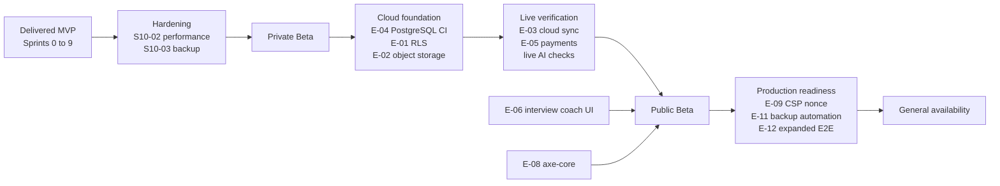

# Development Roadmap

**Product:** Career Application Tracker (Trackr ATS), hybrid local-first career management platform
**Baseline:** `main` at `620f7d8`, 2026-11-18. Phases 0 to 11 complete.
**Purpose:** Position the requested Sprint 0 to Sprint 10 structure against the code that actually exists, expose dependencies and blockers, and define a realistic path to release without inventing calendar dates.

---

## 1. How This Roadmap Was Built

The roadmap was derived by reading the repository, not by assuming progress:

1. Enumerated every route, page, service, schema module, migration, and test file.
2. Checked each requested sprint task for implementation evidence in `src/`.
3. Checked each implemented task for test evidence in `tests/`.
4. Marked a task COMPLETE only when both implementation and passing tests were found.
5. Classified everything else as PARTIAL, NOT STARTED, BLOCKED, or ACCEPTED DEFERRAL.

Full task-level detail lives in [DEVELOPMENT_BACKLOG.md](../DEVELOPMENT_BACKLOG.md). Release gates live in [RELEASE_PLAN.md](RELEASE_PLAN.md).

---

## 2. Sprint Comparison: Requested Structure vs Actual Code

| Requested sprint | Requested scope | Actual implementation | Evidence | Verdict |
|---|---|---|---|---|
| Sprint 0 | Audit, architecture, security review, inventory, baseline tests | Delivered as Phases 0 and 11 audit work | `REPOSITORY_AUDIT.md`, `CURRENT_ARCHITECTURE.md`, `SECURITY_REVIEW_REPORT.md`, `PHASE_PROGRESS_STATUS.md` | COMPLETE |
| Sprint 1 | Archive schema, lifecycle, snapshots, UI, tests | Delivered in Phase 1 | `src/server/services/archive.ts`, archive pages and components, `archive.test.ts`, `phase1-archive.test.ts` | COMPLETE |
| Sprint 2 | Career profile, experience, skills, education, certifications, projects | Delivered in Phase 2 | `src/db/schema/career.ts` (6 tables), `career-profile` service, actions, queries, tests | COMPLETE |
| Sprint 3 | Provider adapters, router, structured output, job processing, consent, usage metadata | Delivered in Phase 3 | `src/server/ai/providers/*`, `router/*`, `schemas/*`, `ai_analysis_jobs`, `AiUsageMetadata` | COMPLETE |
| Sprint 4 | CV parser, evaluation, job matching, skill gap | Delivered in Phase 4 | `src/server/ai/services/*`, `ai-career-features.test.ts` | COMPLETE |
| Sprint 5 | Correction, generation, versioning, PDF/DOCX export, approval | Delivered in Phase 4 CV Studio | `cv-exporter.ts` (native PDF and OOXML DOCX), `cv-studio` page and client, exporter tests | COMPLETE |
| Sprint 6 | Wallet, ledger, reservations, usage accounting, package management | Delivered in Phase 5 | `credits.ts` service (reserve, capture, release, refund, integrity), `credit_packages` schema | COMPLETE with package admin PARTIAL |
| Sprint 7 | Payment abstraction, checkout, webhooks, reconciliation, refunds | Delivered in Phase 6 | Midtrans and Stripe providers, `payments.ts` service, `payments.test.ts` | COMPLETE |
| Sprint 8 | Outbox, endpoints, conflict detection and resolution, sync UI | Delivered in Phase 7 | `src/app/api/v1/sync/*`, `src/server/services/sync.ts`, `sync-center-client.tsx`, `sync.test.ts` | COMPLETE |
| Sprint 9 | English localization, international templates, currency, timezone, privacy docs | Delivered in Phase 9 | Two locale dictionaries, `CV_FORMATS` and five `CV_TEMPLATE_STYLES`, currency and timezone modules, docs 06 and 18 | COMPLETE |
| Sprint 10 | Security audit, performance, backup, migration verification, E2E, readiness report | Partially delivered | Security audit and fixes, 8 migrations, 4 E2E tests, QA audit | PARTIAL (performance and backup testing absent) |

### 2.1 Notable deviations from the requested plan

- **Sprint 3 asked for "AI job processing".** The code persists auditable jobs in `ai_analysis_jobs` and executes them synchronously inside the request. There is no background worker. This is acceptable for MVP but is tracked as E-13.
- **Sprint 5 asked for PDF/DOCX export.** Implemented with dependency-free native writers: a minimal PDF writer and a minimal OOXML ZIP writer. Tests confirm valid output and DOCX text re-extraction.
- **Sprint 6 asked for "credit package management".** The catalog exists in schema, seeds, read API, and pricing updates, but there is no admin CRUD UI. Marked PARTIAL.
- **Sprint 4 listed four AI tasks.** The code adds career roadmap, archive analysis, and interview coach. The interview coach is service-only, not wired to the UI.
- **Sprint 9 asked for "international resume templates".** Implemented as two CV formats (`indonesian_cv`, `international_resume`) and five styles, not as a gallery of visual templates.

---

## 3. Capability Map

| Capability | Source of truth | Automated proof |
|---|---|---|
| Archive lifecycle and snapshots | `src/server/services/archive.ts` | `tests/integration/archive.test.ts`, `tests/unit/phase1-archive.test.ts` |
| Career profile | `src/server/services/career-profile.ts`, `src/db/schema/career.ts` | `tests/integration/career-profile.test.ts` |
| AI providers and routing | `src/server/ai/providers/*`, `src/server/ai/router/*` | `tests/integration/ai-engine.test.ts` |
| AI career features and exports | `src/server/ai/services/*`, `src/server/ai/exporters/cv-exporter.ts` | `tests/unit/phase4-ai-career.test.ts`, `tests/integration/ai-career-features.test.ts` |
| Credits and pricing | `src/server/services/credits.ts` | `tests/unit/phase5-credits.test.ts`, `tests/integration/credits.test.ts` |
| Payments | `src/server/services/payments.ts`, `src/server/payments/providers/*` | `tests/unit/phase6-payments.test.ts`, `tests/integration/payments.test.ts` |
| Sync | `src/server/services/sync.ts`, `src/app/api/v1/sync/*` | `tests/unit/phase7-sync.test.ts`, `tests/integration/sync.test.ts` |
| API v1 | `src/server/api/*`, `src/app/api/v1/*` | `tests/unit/phase8-api.test.ts`, `tests/integration/api-v1.test.ts` |
| Localization | `src/lib/i18n/*` | `tests/unit/phase9-localization.test.ts`, `tests/integration/localization.test.ts` |
| Security controls | `src/lib/crypto.ts`, `src/lib/storage.ts`, `next.config.ts` | `tests/unit/phase10-security.test.ts`, `tests/integration/security.test.ts` |
| Browser journeys | `tests/e2e/*` | `core-journey.spec.ts`, `accessibility.spec.ts` (4 tests) |

---

## 4. Dependency Graph

**Hard dependencies:**

- E-01 (RLS) requires E-04 (PostgreSQL CI) and a cloud database to validate.
- E-02 (object storage) requires a chosen deployment target.
- E-03 (live sync) requires E-01, E-02, and a staging environment.
- E-05 (live payments) requires sandbox credentials and owner approval, independent of the cloud chain.
- E-09 (CSP nonce) requires a Next.js middleware nonce design and a regression pass over uploads and exports.
- S10-02 (performance) and S10-03 (backup) require the deployment target decision but can start on local-first mode.

---

## 5. Critical Path

| Order | Item | Blocks | Why it is critical |
|---|---|---|---|
| 1 | S10-03 backup and restore drill | Private Beta | Entrusting real user data without a proven restore path is unacceptable |
| 2 | S10-02 performance baseline | Private Beta and Public Beta | Without numbers there is no capacity or regression signal |
| 3 | E-04 PostgreSQL CI matrix | E-01, public cloud | Cloud behavior is unverified today |
| 4 | E-01 PostgreSQL RLS | Public Beta cloud tenancy | Tenant isolation is currently application-layer only |
| 5 | E-02 object storage adapter | E-03 | Document files cannot follow users to the cloud |
| 6 | E-03 live cloud sync round-trip | Public Beta | Sync is proven only against in-memory PGlite |
| 7 | E-05 live payment verification | Public Beta commerce | Money flows are tested only against simulated providers |
| 8 | E-12 expanded E2E | Public Beta | AI, sync, and billing UI flows are unverified in a browser |
| 9 | E-09 CSP nonce | Public Beta | `unsafe-inline` remains a residual XSS surface |
| 10 | E-11 automated backups | Production | Manual drills are insufficient for continuous operation |

**Parallelizable work outside the critical path:** E-06 interview coach UI, E-07 credit package admin, E-08 axe-core (after approval), E-10 retention reminders, E-14 CI action upgrades.

---

## 6. Effort Estimates

Assumption: one full-time engineer with the existing stack. Estimates are effort, not calendar dates. S means up to 1 day, M means 2 to 4 days, L means 1 to 2 weeks, XL means 3 or more weeks.

| Work item | Complexity | Estimated effort |
|---|---|---|
| S10-03 backup and restore drill | M | 2 to 3 days |
| S10-02 performance baseline | L | 1 to 2 weeks |
| E-04 PostgreSQL CI matrix | M | 2 to 3 days |
| E-01 PostgreSQL RLS | L | 1.5 to 2.5 weeks |
| E-02 object storage adapter | L | 1 to 1.5 weeks |
| E-03 live cloud sync round-trip | M | 3 to 5 days |
| E-05 live payment verification | M | 3 to 5 days |
| E-12 AI, sync, and credit E2E | L | 1 to 1.5 weeks |
| E-09 CSP nonce tightening | M | 2 to 3 days |
| E-11 automated backups | L | 1 to 1.5 weeks |
| E-06 interview coach UI | M | 3 to 5 days |
| E-08 axe-core scans | S | 1 to 2 days |
| E-10 retention reminders | M | 2 to 3 days |
| E-07 credit package admin | M | 2 to 3 days |
| E-13 background AI worker | L | 1 to 2 weeks |
| E-14 CI action upgrades | S | a few hours |

**Indicative total:** roughly 9 to 13 engineer-weeks for the private beta and public beta hardening scope, excluding external waiting time such as credential approvals and cloud provisioning.

---

## 7. MVP Boundary

**MVP, already implemented:** core ATS, archive, career profile, AI foundation, AI career MVP, CV Studio, credits, payments with simulated providers, hybrid sync, and localization.

**Private beta scope:** MVP plus backup drill, performance baseline, expanded E2E for critical journeys, and a signed readiness report.

**Post-MVP enhancements (not release blockers):** interview coach UI, credit package admin, background AI worker, retention reminders, and CI action upgrades.

**Production cloud scope:** RLS, object storage, live sync, PostgreSQL CI, live payment verification, CSP nonce, and automated backups.

---

## 8. Risks and Controls

The full risk register is maintained in [DEVELOPMENT_BACKLOG.md](../DEVELOPMENT_BACKLOG.md#6-release-risks). The highest-impact items are:

1. **Cloud tenant isolation without RLS.** Accepted deferral DEF-11-006. Do not enable shared-cloud multi-tenancy before E-01.
2. **Unverified live payment flows.** Keep `PAYMENT_MODE=disabled` until E-05 passes with sandbox credentials.
3. **Unmeasured performance.** No capacity claim is valid before S10-02.
4. **No proven restore path.** Complete S10-03 before any private beta data is stored.
5. **Single-maintainer capacity.** Milestones are effort-based. Scope is cut from the milestone, not from quality.

---

## 9. Sequencing Without Calendar Dates

Milestones are expressed as ordered gates, not dates. A milestone is complete when its exit criteria in [RELEASE_PLAN.md](RELEASE_PLAN.md) are met and evidenced.

1. **Internal development (current):** all automated gates green, documentation current.
2. **MVP sign-off:** readiness report accepted, accepted exceptions recorded.
3. **Private beta:** backup drill, performance baseline, expanded critical-path E2E.
4. **Public beta:** cloud foundation and live verification complete.
5. **Production readiness:** operational hardening complete and signed off.

Calendar dates will be estimated only after the deployment target and available capacity are confirmed, because those two inputs dominate the schedule.
